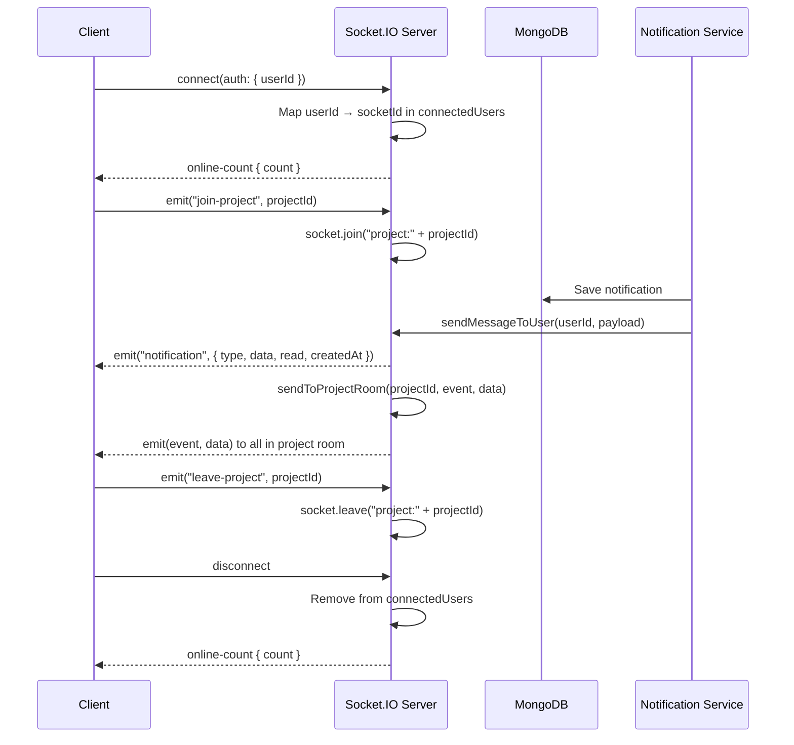

# Collabora8r — Server

**Collabora8r** is a modern project management suite built on the MERN stack. This repository contains the backend API server with real-time collaboration, task management, sprint planning, and team workflows.

[](#)
[](#)

---

## Tech Stack

| Layer | Technology |
|-------|-----------|
| Runtime | Node.js |
| Framework | Express.js |
| Database | MongoDB + Mongoose |
| Auth | JWT (jsonwebtoken + bcryptjs) |
| Real-time | Socket.IO |
| Email | Nodemailer (SMTP) |
| AI | Groq / OpenAI |
| Uploads | Multer |

## Socket.IO Architecture



---

## Documentation

Full API reference: [`docs/api-reference.md`](docs/api-reference.md)

---

## Get Started

```bash
git clone https://github.com/BazilSuhail/Collabora8r-Server.git
cd Collabora8r-Server
npm install
```

Configure `.env` with `MONGO_URI`, `JWT_SECRET`, and optionally `EMAIL_HOST` / `EMAIL_USER` / `EMAIL_PASS`.

```bash
npm start
```

Server runs at `http://localhost:3001`.

---

## Links

- **Live Demo**: [collabora8r.vercel.app](https://collabora8r.vercel.app/)
- **Client Repo**: [Collabora8r-Client](https://github.com/BazilSuhail/Collabora8r-Client)
